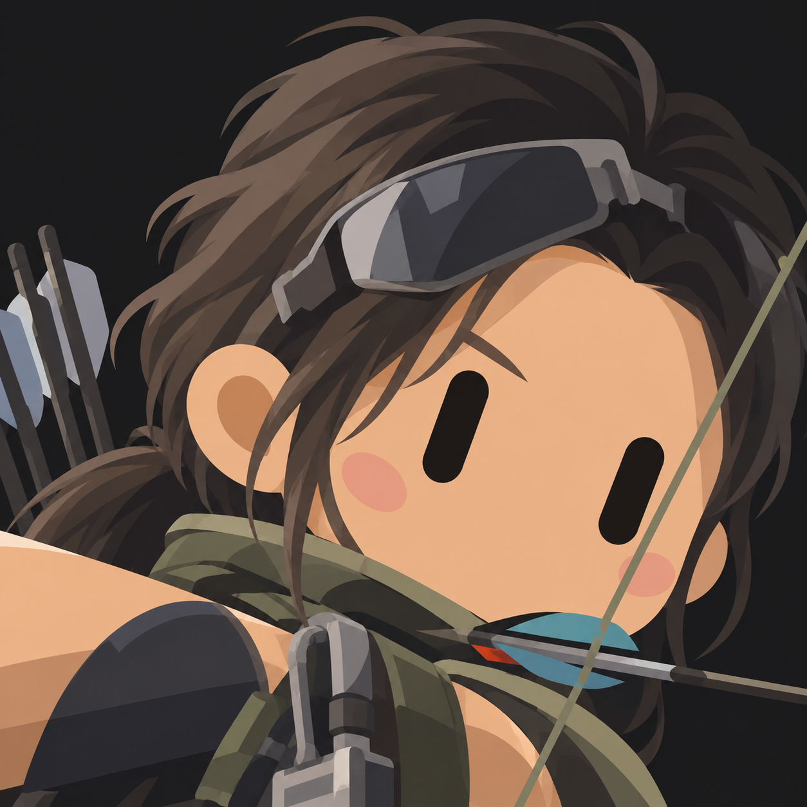
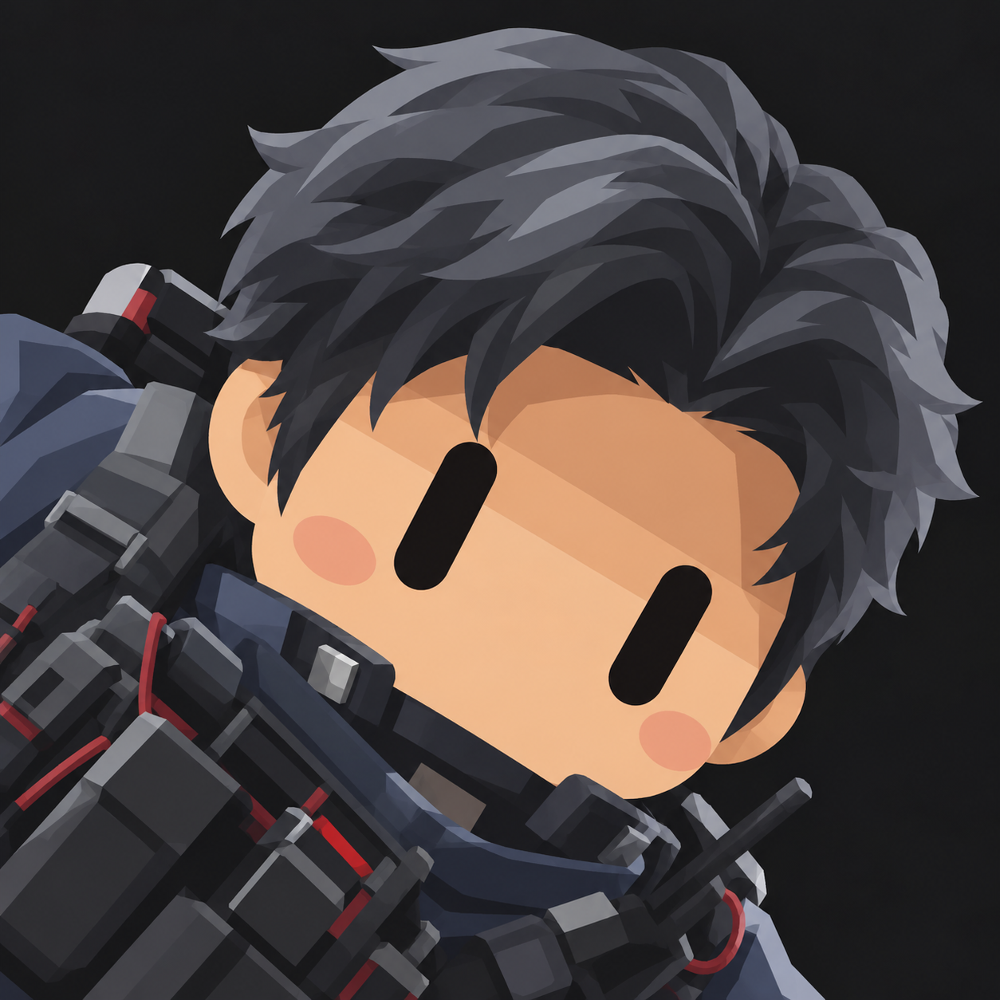
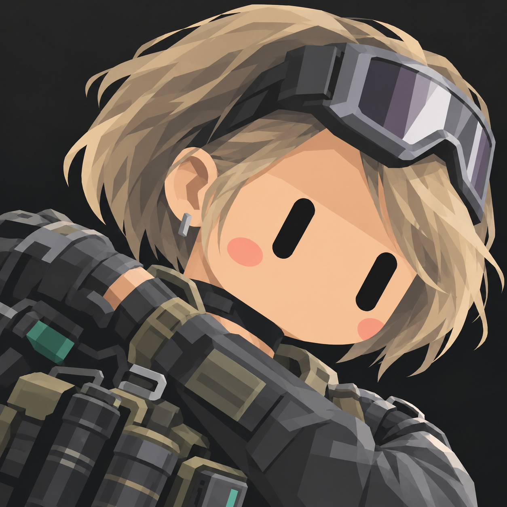
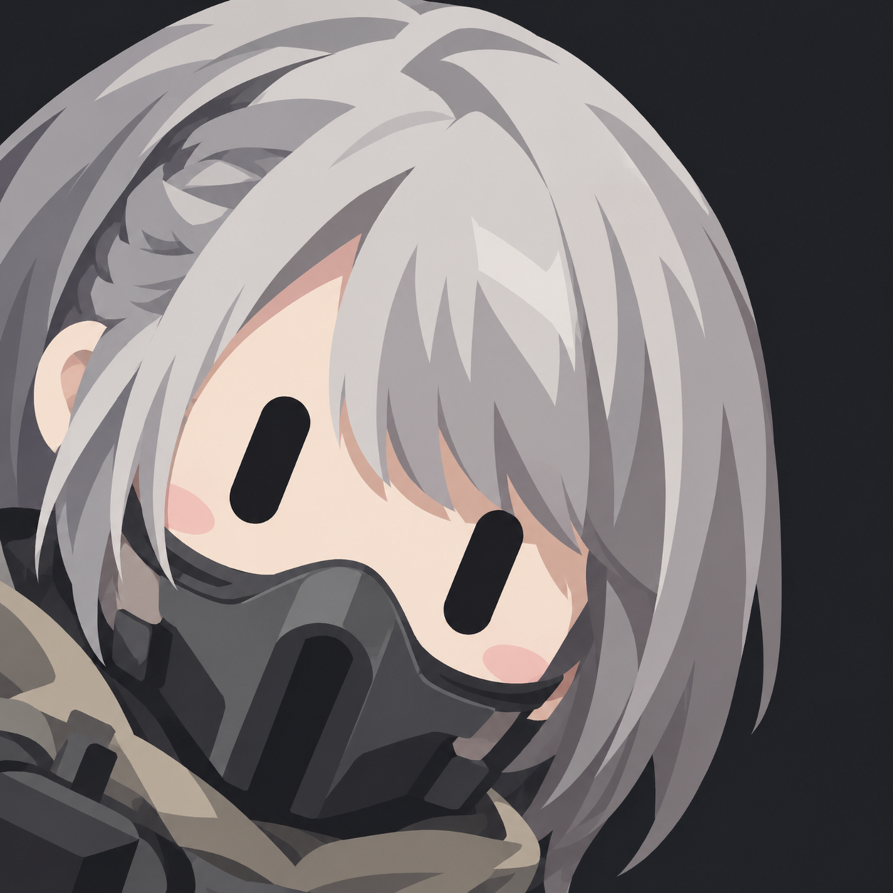
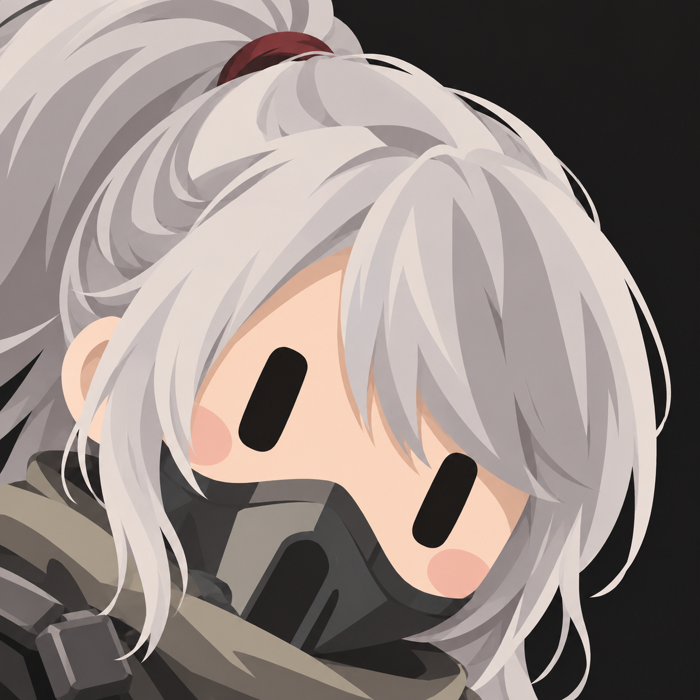
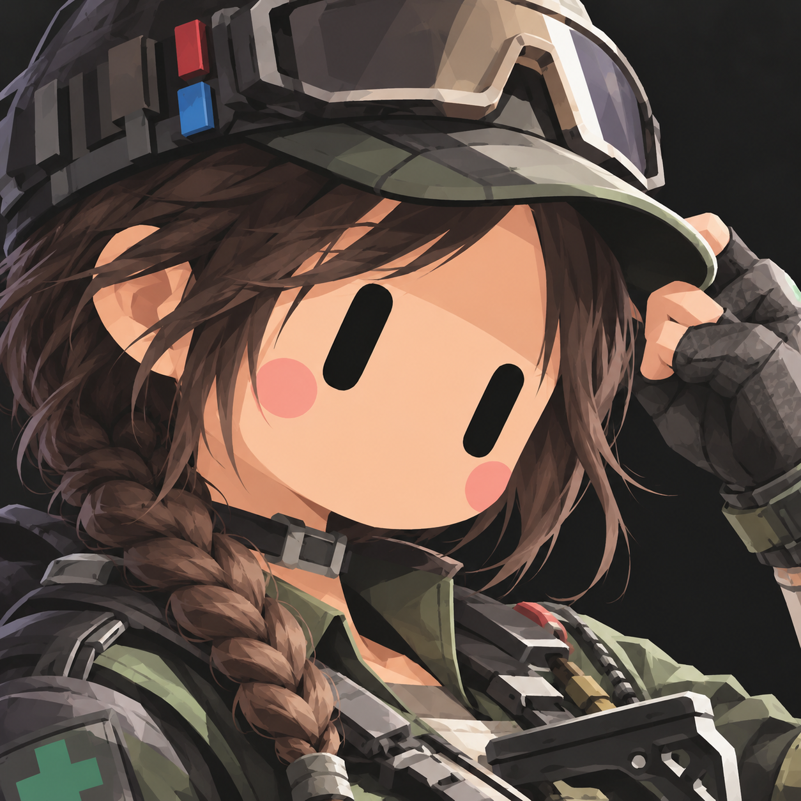
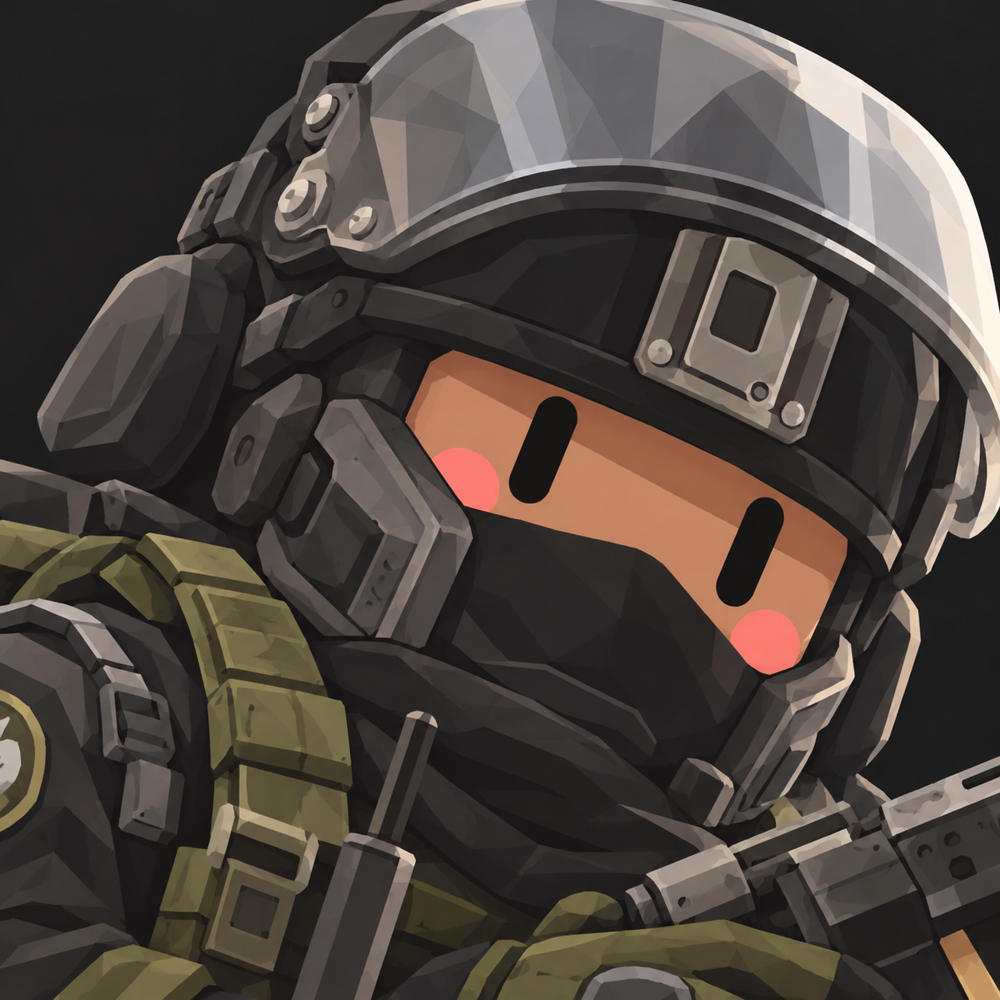
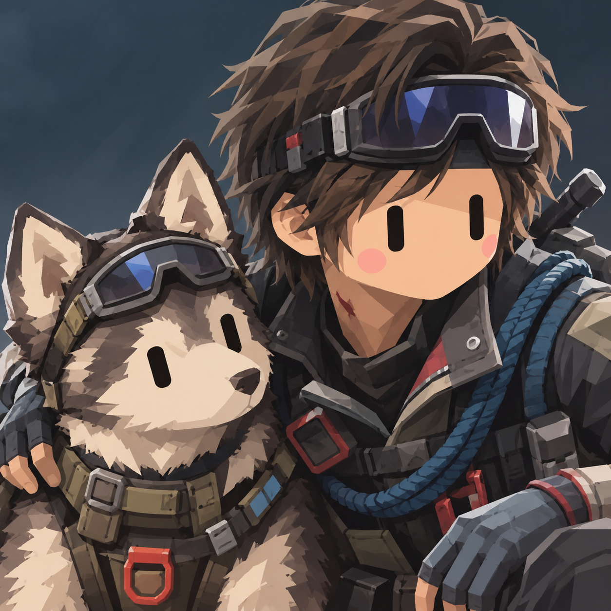
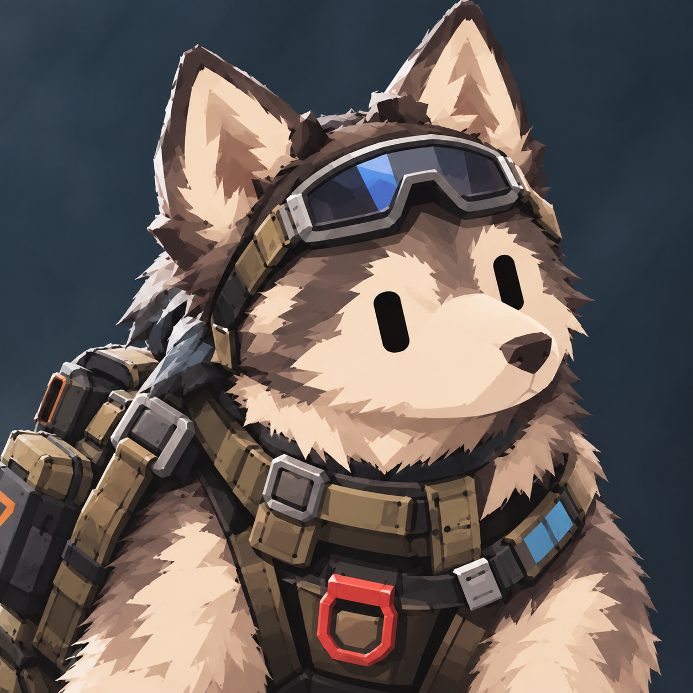
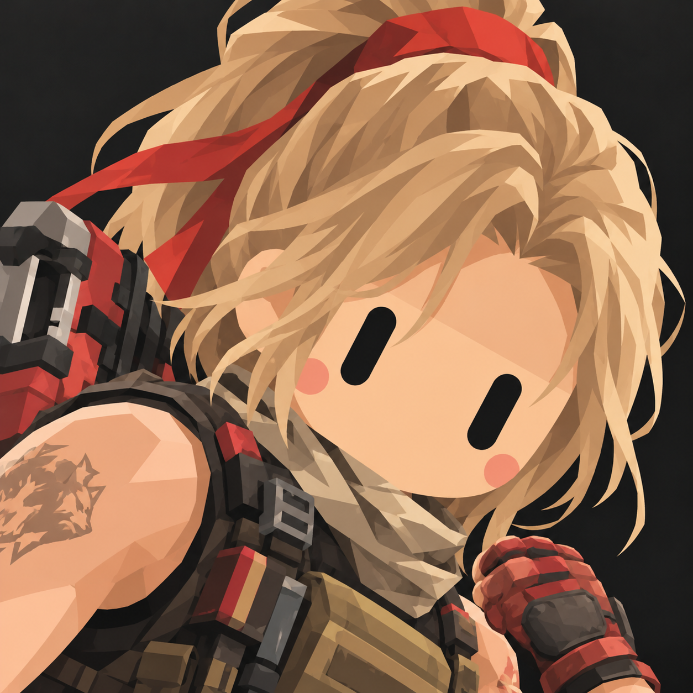

# 三角洲行動

| 突擊 | 支援 | 工程 | 偵察 |
| :---: | :---: | :---: | :---: |
|  紅狼  蝕金玫瑰 |  蜂醫 |  牧羊人  安魂 |  露娜 |
|  威龍  飛虎  凌霄戍衛 |  蠱 |  烏魯魯  狂怒 |  駭爪  水墨雲圖 |
|  無名 |  蝶 |  深藍 |  銀翼 |
|  疾風 |  旅人  羅溫  四葉 |  比特 |  迴響 |
|  野火 | |  液氮 | |
